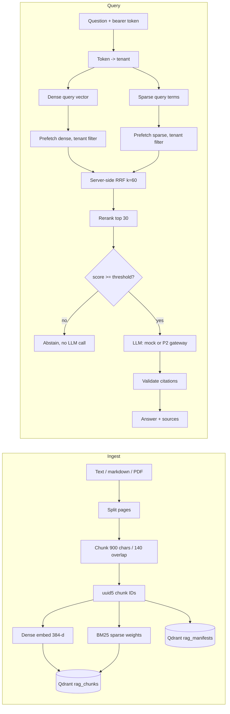
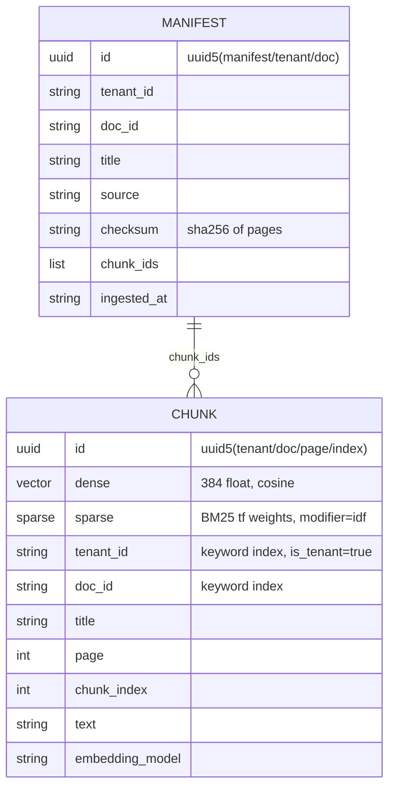

# System design: tenant-scoped hybrid RAG with reranking

## 1. The problem

Employees ask questions such as "How many PTO days can I carry over?" or "What does DEPLOY-4021
mean?" and need an answer drawn only from **their own company's** documents, with a source they
can check. Several companies (tenants) share one deployment.

Naive approaches fail in predictable ways:

- **LLM alone** invents policy numbers.
- **Keyword search alone** misses paraphrases ("vacation roll over" vs "PTO carryover").
- **Vector search alone** blurs exact identifiers: `DEPLOY-4021` and `DEPLOY-4007` embed almost identically.
- **Filtering tenants after retrieval** can leak another tenant's text into the prompt, and it lowers recall because the top-N gets filled with chunks that are then discarded.
- **Trusting document text** lets a planted "ignore all previous instructions" steer the model.

## 2. Requirements

**Functional (core)**
1. Ask a question as an authenticated user; get an answer with citations (doc, title, page).
2. Retrieve with dense and lexical signals combined, then rerank.
3. Abstain, without calling the LLM, when evidence is weak.
4. Ingest text or PDF into the caller's tenant; re-ingest replaces the old version.

**Out of scope:** OCR, per-document ACLs inside a tenant, async ingestion workers, streaming answers, a UI.

**Non-functional (design targets, not measured results)**

| Target | Value |
|---|---|
| Tenant isolation | zero cross-tenant chunks in any retrieval stage |
| p95 query latency (excluding LLM) | < 300 ms at 1M chunks with real models |
| Ingest idempotency | same input twice gives the same point IDs and point count |
| Citation accuracy | 100% of returned citations reference evidence shown to the model |
| Availability | 99.9% for the query path |

## 3. Core entities

| Entity | Key fields |
|---|---|
| Principal | `tenant_id`, `user_id` (from bearer token) |
| Document | `tenant_id`, `doc_id`, `title`, `source`, `checksum` |
| Chunk (Qdrant point) | `id = uuid5(tenant/doc/page/index)`, dense + sparse vectors, payload |
| Manifest | one per (tenant, doc): list of chunk IDs, checksum, `ingested_at` |
| Evidence | `ref` (`C1`...), chunk, rerank score |
| Answer | text, `abstained`, citations, debug trace |

## 4. API / system interface

| Method | Path | Body | Response |
|---|---|---|---|
| GET | `/healthz` | | `{"status":"ok"}` |
| POST | `/v1/rag/ask` | `{"question": str, "top_k": 1..10 = 5}` | `{request_id, answer, abstained, citations[], retrieved_doc_ids[], debug, latency_ms}` |
| POST | `/v1/rag/ingest` | JSON `{doc_id, text, title?}` or multipart `file` (PDF), `doc_id`, `title?` | `{tenant_id, doc_id, status: created/updated/unchanged, chunks, removed}` |
| GET | `/v1/rag/documents` | | `{tenant_id, documents[]}` |

All `/v1` routes need `Authorization: Bearer <token>`; missing or unknown token gives 401.
Errors: 415 not a PDF, 422 corrupt/encrypted/no-text PDF or bad `doc_id`, 413 over 5 MiB,
502 `llm_gateway_error` in gateway mode.

Citation shape: `{"ref":"C1","chunk_id":"...","doc_id":"acme-pto-policy","title":"PTO Policy","page":2,"rerank_score":0.82}`.

## 5. High-level design



How each functional requirement is met:

1. **Cited answers:** evidence is numbered `[C1]..[Ck]` in the prompt; `validate_citations` keeps only refs that exist and maps them back to doc/title/page.
2. **Hybrid retrieval:** one Qdrant Query API call with two `Prefetch` branches (`using="dense"`, `using="sparse"`), each carrying the same tenant filter, fused with `RrfQuery(k=60)`. The reranker then reorders the fused top 30.
3. **Abstention:** if no reranked candidate scores at least `RAG_RERANK_THRESHOLD` (0.35), the pipeline returns an abstention and `debug.llm_called=false`. It also abstains if the model says `INSUFFICIENT_EVIDENCE` or returns no valid citation.
4. **Ingest lifecycle:** deterministic IDs make retries idempotent; the manifest records each document's chunk IDs so a shorter re-ingest deletes the stale ones.

## 6. Low-level design

### Ingest sequence

```mermaid
sequenceDiagram
  participant C as Client
  participant API as rag-api
  participant P as Pipeline
  participant Q as Qdrant
  C->>API: POST /v1/rag/ingest (token, doc_id, text or PDF)
  API->>API: token -> tenant; validate doc_id, size, PDF magic/encryption
  API->>P: ingest_pages(tenant, doc_id, pages)
  P->>P: checksum, chunk_text per page, uuid5 IDs
  P->>Q: retrieve manifest(tenant, doc_id)
  alt same checksum
    P-->>API: unchanged
  else new or changed
    P->>Q: upsert points (dense + sparse + payload), wait=true
    P->>Q: delete old_ids - new_ids
    P->>Q: upsert manifest
    P-->>API: created/updated, chunks, removed
  end
```

### Query sequence

```mermaid
sequenceDiagram
  participant C as Client
  participant API as rag-api
  participant Q as Qdrant
  participant R as Reranker
  participant L as LLM
  C->>API: POST /v1/rag/ask (token, question)
  API->>API: token -> tenant (body tenant ignored)
  API->>Q: query_batch: dense(acl), sparse(acl), prefetch[dense(acl), sparse(acl)] + RRF
  Q-->>API: dense top30, sparse top30, fused top30
  API->>R: predict(question, chunk) x 30
  R-->>API: scores
  alt no score >= threshold
    API-->>C: abstained=true (LLM not called)
  else
    API->>L: system rules + "[C1] ..." evidence + question
    L-->>API: answer citing [Cn]
    API->>API: drop invalid refs; abstain if none valid
    API-->>C: answer, citations, debug
  end
```

The dense-only and sparse-only queries in the batch exist for the debug trace and the ablation;
production could send only the fused query.

### Data schema



### Algorithms

**Chunking** (`app/text.py: chunk_text`). Whitespace-normalized windows of 900 characters. The
end snaps back to the last sentence end if it lies in the second half of the window, otherwise
to the last space. The next window starts 140 characters before the previous end, snapped
forward to a word boundary. Chunks never span pages, so page citations stay exact.

**Dense embedding** (`app/encoders.py: HashingEmbedder`). Features: words (after a small concept
map, e.g. vacation -> pto), word bigrams, and character trigrams per word. Each feature hashes
(BLAKE2b) to one of 384 buckets with a hashed sign; the vector is L2-normalized. Stored as a
cosine named vector `dense`.

**BM25 sparse** (`BM25SparseEncoder`). Document side stores the BM25 term-frequency part:

`w(t,d) = tf · (k1 + 1) / (tf + k1 · (1 − b + b · |d| / avgdl))`, with k1 = 1.2, b = 0.75, avgdl = 70.

Query side sends weight 1 per term. The collection's sparse vector uses `modifier: idf`, so Qdrant
multiplies each term by its IDF computed over the indexed points at query time. The dot product is
then `Σ_t idf(t) · w(t,d)`, the BM25 score. IDF is collection-wide; the tenant filter restricts
which documents are scored but not the IDF statistics (see deep dive 7.4). Term IDs are 32-bit
BLAKE2b hashes of tokens. Identifiers like `deploy-4021` are kept as one token plus their parts.

**RRF** (`app/ranking.py: rrf`). `score(d) = Σ_i 1 / (k + rank_i(d))`, k = 60, rank from 1.
Qdrant computes the same thing server-side via `RrfQuery(rrf=Rrf(k=60))`; the API recomputes it
locally into `debug.rrf_local`, and a test asserts the top 5 agree.

**Reranker** (`SimulatedCrossEncoder`). `0.7 · weighted term coverage + 0.3 · query-bigram match
ratio`, plus 0.2 if every query identifier appears in the passage or minus 0.3 if one is missing.
The score is halved when the query's most specific term (the heaviest-weighted one) is absent, so
"parental leave policy" does not match a sick-leave passage on two shared words. The result is
clamped to [0, 1]. Term weight is 2.0 for identifiers, else `1 + min(len, 10)/10`. It implements
the `Reranker` protocol (`predict(pairs) -> list[float]`), so a real
`cross-encoder/ms-marco-MiniLM-L-6-v2` drops in without other changes.

### Key code paths

| Concern | File / function |
|---|---|
| Auth | `app/main.py: principal` |
| Hybrid query | `app/store.py: VectorStore.search` |
| Idempotent upsert + stale removal | `app/store.py: VectorStore.upsert_document` |
| Rerank + abstain + generate | `app/pipeline.py: RagPipeline.ask` |
| Prompt, citation validation, injection flags | `app/llm.py` |

## 7. Deep dives

### 7.1 Tenant isolation

- **Problem:** a shared index must never return tenant B's text to tenant A.
- **Bad:** take `tenant_id` from the request body, or filter results after retrieval. The first is spoofable; the second leaks into intermediate stages and loses recall.
- **Good:** derive the tenant from a verified token and pass a filter to the vector search.
- **Great:** filter inside **every** retrieval branch (each prefetch), index `tenant_id` as a tenant key so Qdrant co-locates a tenant's points, and test every stage of the trace, not just the final answer. At large scale, move big tenants to their own shards or collections.
- **This repo:** token table to principal; the same `tenant_filter` on both prefetches and the outer query; `is_tenant=true` keyword index; tests check dense, sparse and fused traces contain only acme docs, and that a body `tenant_id` is ignored.

### 7.2 Retrieval quality (exact identifiers and paraphrases)

- **Problem:** dense search misses exact codes; lexical search misses paraphrases.
- **Bad:** add raw cosine and BM25 scores. They are on different scales, so one dominates.
- **Good:** RRF over ranks, which needs no score calibration.
- **Great:** RRF over generous candidate sets (30 per branch), a cross-encoder over the fused top 30, and weights and limits tuned on a labeled validation set with Recall@k and MRR tracked per ablation.
- **This repo:** server-side RRF, simulated cross-encoder, `scripts/ablation.py` on 12 labeled questions. Observed on that tiny set: dense Recall@5 1.00 / MRR 0.958; sparse 0.92 / 0.917 (misses the "Christmas holidays" paraphrase); fused 1.00 / 0.933; fused+rerank 1.00 / 0.958. The set is far too small to show that hybrid beats dense, and the dense model here is a hashing stand-in that shares the concept map with the reranker. The `DEPLOY-4021` test shows the sparse branch ranking the exact identifier first, which is the behaviour that matters.

### 7.3 Grounding and prompt injection

- **Problem:** the model may invent facts or citations, and retrieved text may contain instructions.
- **Bad:** paste chunks into the prompt and return whatever the model says.
- **Good:** numbered evidence, a system rule that evidence is data, and an abstain path.
- **Great:** also validate citations against the evidence list, neutralize citation-like markers inside chunks, flag instruction-like chunks for monitoring, never give the answer step tools, and rely on retrieval-time isolation so another tenant's data cannot be in context at all.
- **This repo:** all of the above. The vendor-onboarding injection is retrieved for acme but the mock skips instruction-like sentences, the answer contains no Globex data (it cannot: Globex chunks are never retrieved), and `debug.suspicious_chunk_ids` records the flagged chunk.

### 7.4 BM25 IDF across tenants

- **Problem:** IDF computed over all tenants lets one tenant's vocabulary shift another's ranking and leaks a weak statistical signal about term frequency elsewhere.
- **Bad:** ignore it.
- **Good:** accept collection-wide IDF for small, similar tenants and document it.
- **Great:** per-tenant collections (or shards) for large tenants, or compute IDF per tenant at ingest and store full BM25 weights.
- **This repo:** collection-wide IDF via Qdrant `modifier: idf`. Chosen because it keeps stored weights valid as documents arrive; per-tenant IDF would require re-weighting all of a tenant's points on every ingest.

### 7.5 Document lifecycle

- **Problem:** stable IDs alone leave orphan chunks when a document shrinks.
- **Bad:** delete-then-insert without a record (window with missing data; crash leaves the doc empty).
- **Good:** manifest of chunk IDs per document; upsert new, delete the difference.
- **Great:** versioned documents with tombstones, a write-ahead job record, and a background reconciler.
- **This repo:** manifest with checksum; unchanged checksum is a no-op; upsert-then-delete-stale order means a crash mid-ingest leaves extra chunks rather than missing ones.

## 8. Real vs simulated

| Production component | This repo |
|---|---|
| Vector DB with hybrid search | **Real** Qdrant v1.20.2: named dense + sparse vectors, Query API prefetch, server-side RRF |
| BM25 | **Real** BM25 math: TF part computed in Python, IDF applied by Qdrant (`modifier: idf`) |
| Dense model `all-MiniLM-L6-v2` | **Simulated:** hashed word/bigram/char-trigram embedder, 384-d, plus a hand-written concept map |
| Cross-encoder `ms-marco-MiniLM-L-6-v2` | **Simulated:** deterministic term-coverage + phrase + identifier scorer behind the same interface |
| LLM | **Simulated** extractive mock by default; **real** HTTP call to Project 2 gateway in `gateway` mode |
| OIDC / JWT | **Simulated:** static token table |
| PDF parsing | **Real** pypdf (text PDFs only, no OCR) |
| Async ingest workers, malware scan, PII handling | Not implemented |

## 9. Failure modes and testing

| Failure | Behaviour | Test |
|---|---|---|
| Missing/invalid token | 401 | `test_unauthenticated_is_401` |
| Body claims another tenant | ignored, caller's tenant used | `test_tenant_field_in_body_is_ignored` |
| Same question across tenants | each sees only its own docs | `test_tenant_isolation_carryover` |
| Exact identifier query | sparse branch ranks it first | `test_exact_identifier_found_by_sparse_branch` |
| Server RRF disagrees with formula | test fails | `test_server_rrf_matches_local_rrf` |
| Injection in a chunk | not followed, flagged, no foreign data | `test_prompt_injection_does_not_leak_or_steer`, `test_mock_llm_skips_injection_sentences` |
| Out-of-scope question | abstain, LLM not called | `test_abstains_without_calling_llm` |
| Model cites a ref that doesn't exist | ref dropped | `test_citation_validation_drops_invalid_refs` |
| Chunk text contains `[C9]` | neutralized to `(C9)` | `test_evidence_cannot_forge_citation_ids` |
| Re-ingest same or shorter doc | no-op / stale chunks deleted | `test_ingest_is_idempotent_and_removes_stale_chunks` |
| Non-PDF upload | 415 | `test_pdf_upload` |
| Gateway down | 502 `llm_gateway_error`, no mock fallback | `test_gateway_failure_is_explicit` |
| Bad chunk parameters | `ValueError` | `test_empty_short_and_malformed_inputs` |
| Qdrant unreachable at startup | API retries 30 s then fails to start; integration tests skip | `conftest.py` |

## 10. Interview cheat sheet

**60-second pitch.** "I built a multi-tenant RAG service on Qdrant. Each question runs two
retrievers in one Query API call, a dense vector and a BM25 sparse vector, each with the tenant
filter applied inside the branch, fused with reciprocal-rank fusion on the server. A cross-encoder
interface reranks the top 30, and if nothing clears a threshold we abstain without paying for an
LLM call. The prompt numbers the evidence, and we validate every citation the model returns.
Ingestion uses deterministic chunk IDs and a per-document manifest, so retries are idempotent and
re-ingests delete stale chunks. Tests run against a live Qdrant and cover tenant isolation, exact
identifier recall, prompt injection, and abstention."

**Likely questions**

1. *Why not just vector search?* Embeddings blur exact tokens like `DEPLOY-4021`; BM25 matches them literally. RRF combines ranks without pretending the scores are comparable.
2. *Why RRF instead of a weighted score sum?* Cosine and BM25 live on different scales that shift per query; ranks are scale-free. k=60 damps the influence of any single top rank.
3. *Why filter inside each prefetch?* Post-filtering leaks foreign chunks into intermediate results and lets other tenants' chunks consume the top-N, lowering recall.
4. *Why rerank only 30?* Cross-encoders score each pair with a full forward pass; cost is linear in candidates. 20 to 100 is the usual range.
5. *Is the rerank score a confidence?* No, it is a ranking signal. The threshold is tuned on labeled answerable/unanswerable questions, not read as a probability.
6. *How do you stop prompt injection?* Isolation at retrieval, evidence-as-data instructions, no tools at the answer step, citation validation, and flagging instruction-like chunks. None of these alone is sufficient.
7. *How do you handle document updates?* Manifest of chunk IDs and checksum; upsert new IDs, delete the difference.
8. *How do you know retrieval improved?* Labeled queries, Recall@5 and MRR per ablation (dense, sparse, fused, fused+rerank), plus latency. This repo's 12-question set only demonstrates the harness.
9. *What breaks at scale?* Collection-wide IDF across tenants, reranker latency, and large tenants needing their own shards.

**Trade-offs.** Server-side RRF is one round trip but less flexible than client-side fusion with
per-branch weights. Collection-wide IDF keeps ingest cheap but couples tenants' statistics.
Abstaining on a fixed threshold is cheap and safe but needs calibration per corpus.

**Scaling story.** 10x: batch embeddings, async ingest queue, cache query embeddings, run the
reranker on GPU or a smaller distilled model. 100x: shard by tenant (custom sharding or
per-tenant collections for large tenants), replicate Qdrant for read throughput, quantize dense
vectors, cap context tokens, and track p95 per stage.

**Resume bullet.**
> Built a tenant-scoped hybrid RAG service on Qdrant (dense + BM25 sparse vectors, server-side reciprocal-rank fusion, cross-encoder reranking) with validated citations, abstention, idempotent ingestion and tenant-isolation tests; improved Recall@5 from [measured] to [measured] on [N] labeled queries at [measured] p95 latency.
